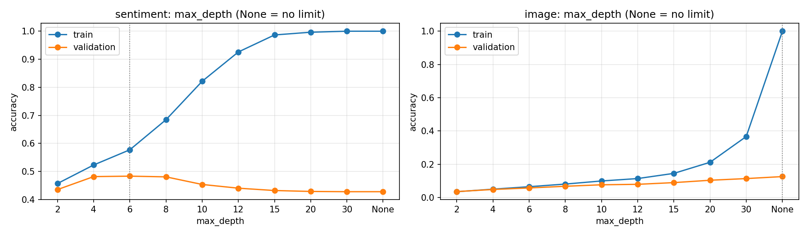
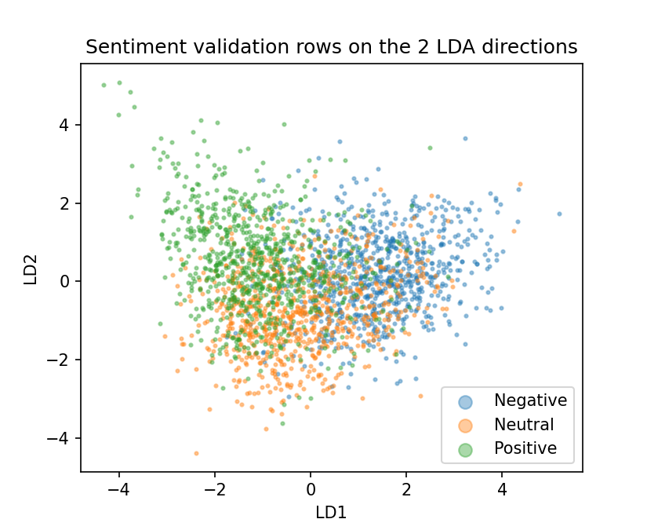
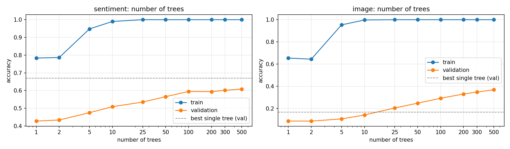
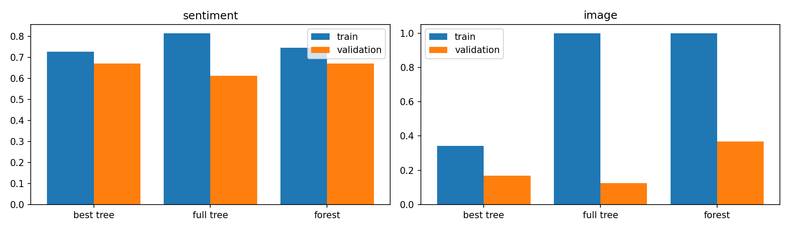
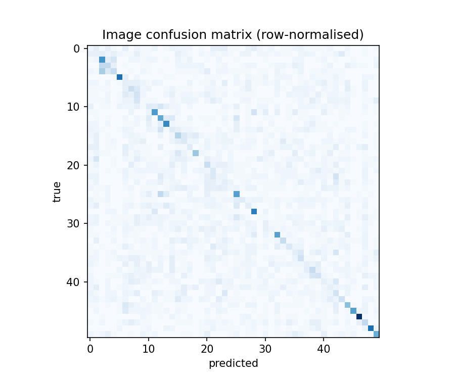
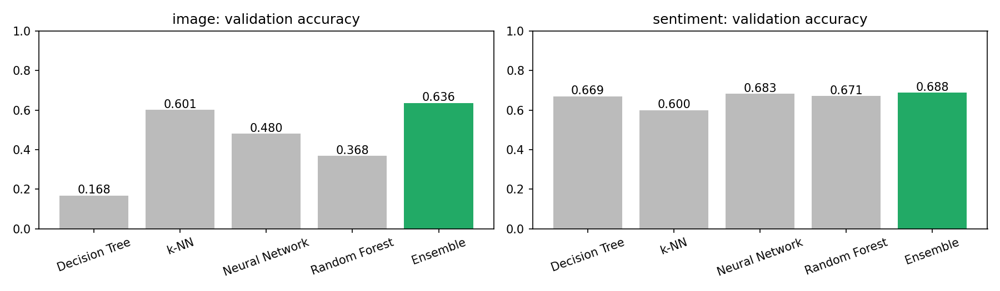

# Decision Tree and Random Forest

All numbers are validation accuracy on our shared stratified 80/20 split (`common.stratified_split`, seed 42;
image 16,000 / 4,000 rows, sentiment 9,600 / 2,400 rows) and come from
`decision_tree/decision_tree.ipynb` and `random_forest/random_forest.ipynb`.

## 1. Architecture and implementation

Both models are written from scratch in NumPy in `trees.py`; no scikit-learn code is used.

**Decision Tree (CART).** Each internal node asks *"is feature f ≤ t?"*. A node is split with the question
that maximises the impurity decrease

    gain = I(parent) − (n_L / n)·I(left) − (n_R / n)·I(right),   I = Gini (1 − Σ p_c²) or entropy (−Σ p_c log₂ p_c)

Growth is greedy and depth-first. A node becomes a leaf when it is pure, `max_depth` is reached, it has fewer
than `min_samples_split` rows, or no allowed question has positive gain. A question is allowed only if both
children keep at least `min_samples_leaf` rows. A leaf stores its class distribution and predicts the most
common class.

*Histogram split search.* Testing every value of every feature is too slow (20,000 rows × 500 features).
Before training, each feature gets at most 63 candidate thresholds (quantiles), and every value is replaced
by its bin index. At a node, one `np.bincount` builds a (feature × bin × class) count table, and a cumulative
sum over bins gives the class counts left of every threshold. The gain of every candidate question is
therefore computed in one vectorised step. This is the same exhaustive search as in Lab 5, which tries the
midpoint between every pair of consecutive values, restricted to 63 quantile thresholds per feature. With
more than 63 thresholds, accuracy does not improve (section 5.5 of the notebook).

*Zero-aware thresholds.* 85% of the image feature values are exactly 0. Plain quantiles put most thresholds
of a feature at 0: on average only 10 distinct thresholds per feature were left. Our binner adds quantiles of
the non-zero values, which gives 63 distinct thresholds. With the same tree settings, image validation
accuracy goes from 0.115 to 0.134.

*Engineering.* Nodes hold row indices instead of copies of the data. The fitted tree is stored as flat arrays,
and prediction moves all rows down the tree together. A fully grown image tree now trains in about 60 s
(our first version took 760 s).

**Random Forest.** There are `n_trees` trees, each trained on a bootstrap sample (n rows drawn with
replacement). At every split a tree looks only at `max_features` randomly chosen features. Prediction uses
**soft voting**: the average of the trees' leaf class distributions. The data is binned once and shared by
all trees, and the trees are trained in parallel processes. The forest also reports **out-of-bag (OOB)**
accuracy: each training row is predicted only by the trees that did not see it.

**LDA projection (preprocessing).** Fisher Linear Discriminant Analysis, also implemented in NumPy, projects
the data onto the at most C − 1 directions that maximise between-class over within-class variance: 2
directions for sentiment, 49 for image. The within-class covariance is shrunk towards a scaled identity,
`(1 − s)·S_w + s·(tr S_w / d)·I`, and `s` is a hyper-parameter. LDA is fitted on training rows only; for the
test predictions it is re-fitted on all training rows. The project rules allow dimensionality reduction, and
LDA does not add any outside information.

## 2. Hyper-parameters and training methodology

Every setting is chosen by validation accuracy. The test set is used only once, after the final model is
refitted on all training rows.

| Experiment | Values tried |
|---|---|
| DT `max_depth` | 2, 4, 6, 8, 10, 12, 15, 20, 30, None |
| DT `min_samples_split` | 2, 10, 25, 50, 100, 200, 400 |
| DT `min_samples_leaf` | 1, 2, 5, 10, 20, 50, 100 |
| DT criterion | Gini, entropy |
| DT depth × leaf grid | 5 × 5 (sentiment), 4 × 5 (image) |
| DT candidate thresholds (`n_bins`) | 8, 16, 32, 64, 128, 256 |
| DT on LDA features | shrinkage 0, 0.1, 0.3, 0.5, 0.8 × depth |
| RF number of trees | 1 … 500 (one 500-tree forest, evaluated on its first k trees) |
| RF `max_features` | sentiment 3, 9, √768 = 27, 60, 150; image 3, 5, 10, √500 = 22, 50, 100 |
| RF `max_depth` / `min_samples_leaf` | 5, 10, 20, None / 2, 5, 10 |
| RF criterion, bootstrap size, voting | Gini vs entropy; 25%, 50%, 100% of n; soft vs hard |
| RF representation | raw, LDA, raw + LDA (shrinkage 0.1, 0.3, 0.5) |

**Selected models**

| Task | Model | Features | Settings | Train acc | Val acc |
|---|---|---|---|---|---|
| Sentiment | Decision Tree | LDA, s = 0.3 | max_depth 8, min_samples_leaf 20, Gini | 0.725 | **0.669** |
| Sentiment | Random Forest | LDA, s = 0.1 | 500 trees, max_features 1, min_samples_leaf 20 | 0.744 | **0.671** |
| Image | Decision Tree | LDA, s = 0.5 | no depth limit, min_samples_leaf 20, Gini | 0.341 | **0.168** |
| Image | Random Forest | raw | 500 trees, max_features √500, min_samples_leaf 2, Gini | 1.000 | **0.369** |

Before this work (first version, raw features only): DT 0.485 / 0.119 and RF 0.573 / 0.239 (sentiment / image).

## 3. Results and discussion

### Depth: under-fitting vs over-fitting (Decision Tree)

| max_depth | 2 | 6 | 10 | 15 | None |
|---|---|---|---|---|---|
| Sentiment train / val | 0.457 / 0.435 | 0.577 / **0.483** | 0.822 / 0.454 | 0.987 / 0.432 | 1.000 / 0.428 |
| Image train / val | 0.035 / 0.036 | 0.065 / 0.058 | 0.099 / 0.077 | 0.145 / 0.090 | 1.000 / **0.126** |

* **Sentiment:** validation accuracy peaks at depth 6. Deeper trees push training accuracy to 1.0 while
  validation falls by 5.5 points: textbook over-fitting. Depth 2 under-fits, with train and validation
  both low and close together.
* **Image:** with 50 classes a tree needs at least log₂ 50 ≈ 6 levels just to name every class, so shallow
  trees under-fit badly. Validation keeps creeping up to full depth (0.126), but the train/validation gap is
  0.87. The tree memorises the training set and generalises poorly.
* `min_samples_leaf` and `min_samples_split` act as smoother brakes than a depth cap. The best image tree
  (min_samples_leaf 10, raw features) reaches 0.134, and sentiment reaches 0.492 at min_samples_leaf 100.
  Gini and entropy are within 0.01 on sentiment, and Gini is clearly better on image (0.134 vs 0.099).

### Why trees are weak here, and what LDA changes

A tree splits on **one feature at a time**, so its decision boundaries are axis-aligned staircases (see the
toy example in the notebook). Both feature sets spread class evidence across many coordinates. Sentiment is a
direction in a 768-dimensional BERT space; image evidence is spread over many sparse features. After
projecting onto the LDA directions, those directions *are* the axes:

* **Sentiment: 0.483 → 0.669** for a single tree. A tree with only 3 questions on the 2 LDA directions already
  reaches 0.663, and the best tree (339 nodes) adds less than one point. So most of the gain comes from the
  projection itself: the tree mainly learns where to cut the two discriminant axes.
* **Image: 0.134 → 0.168.** LDA helps much less: 49 linear directions cannot separate 50 visual classes
  well with 320 training images each.

### Random Forest vs a single tree

| Task | Model | Train | Val | Gap |
|---|---|---|---|---|
| Image (raw) | one fully grown tree | 1.000 | 0.126 | 0.874 |
| Image (raw) | Random Forest, 500 trees | 1.000 | **0.369** | 0.631 |
| Sentiment (raw) | one fully grown tree | 1.000 | 0.428 | 0.572 |
| Sentiment (raw) | Random Forest, 500 trees | 1.000 | 0.608 | 0.392 |
| Sentiment (LDA) | best single tree | 0.725 | 0.669 | 0.056 |
| Sentiment (LDA) | Random Forest, 500 trees | 0.744 | 0.671 | 0.073 |

* On raw features the forest triples image accuracy (0.126 → 0.369) and adds 18 points on sentiment, using the
  same tree code. Every tree still fits its own bootstrap sample perfectly. Averaging many decorrelated trees
  **reduces variance**; it does not reduce bias, which is why training accuracy stays at 1.0.
* **Number of trees** (image validation): 1 tree 0.087, 10 trees 0.142, 50 trees 0.248, 100 trees 0.292,
  300 trees 0.348, 500 trees 0.369. Accuracy keeps rising and never drops, so more trees do not cause
  over-fitting; they only cost time, which grows linearly (500 image trees: about 2 min on 18 cores).
* **max_features:** image is best around 5–22 features per split (0.329–0.331) and worse at 100 (0.311).
  Fewer features make the trees more different from each other, which averaging needs. Sentiment on raw
  features prefers more features (150: 0.599 vs 3: 0.575), because single BERT dimensions are individually
  very weak.
* **Limiting the trees hurts a forest**, unlike a single tree: on image, depth 10 gives 0.190 vs 0.331
  unlimited, and min_samples_leaf 10 gives 0.289. Smaller bootstrap samples also hurt (25%: 0.269). Soft and
  hard voting are nearly tied (0.331 vs 0.330); entropy is worse on image (0.314).
* On LDA sentiment features, the forest barely beats the best single tree (0.671 vs 0.669). With only 2
  input features there is little diversity for the forest to exploit.
* **OOB caveat.** On raw image features, OOB accuracy (0.329) is close to validation at about 200 trees, as
  expected: each row is out-of-bag for roughly 37% of the 500 trees. On LDA sentiment features, OOB is
  **optimistic** (0.724 vs 0.671 validation), because LDA was fitted on all training rows and so has already
  seen the labels of the "out-of-bag" rows. A held-out validation set is the safer estimate whenever there
  is a supervised preprocessing step.

### Error analysis

* **Sentiment:** Neutral is the hardest class for both tree models (forest recall 0.56, F1 0.58, vs 0.77 and
  0.73 for Negative). Neutral examples are confused with both neighbours (175 → Negative, 174 → Positive out
  of 800), while Negative ↔ Positive errors are rarer (53 and 93). Sentiment lies on a scale, and Neutral sits
  in the middle of it.
* **Image:** the forest's most frequent confusions are 4 → 2 (20 of 80), 3 → 2 (19), 27 → 25 (11), 10 → 12
  and 34 → 32 (10 each). Class 2 absorbs many neighbours; these pairs are probably visually similar
  categories. Classes 22, 29, 21, 6 and 40 have recall ≤ 0.16; classes 48, 5, 46, 25 and 13 have recall
  ≥ 0.66.
* **Confidence is meaningful:** on sentiment, rows where the forest's top probability is above 0.87 are 85%
  correct, versus 50% below 0.60. On image, the most confident quarter is 66% correct and the least confident
  quarter 14%.
* **The tree models make different mistakes:** on image validation rows, the forest is right and the best
  single tree wrong 979 times; the reverse happens 176 times.
* **Feature importance:** the forest spreads its importance widely on image (190 of 500 features hold half
  of it, and no feature has more than 0.5%). This matches the observation that image class evidence is
  distributed rather than concentrated, which is exactly what one-feature-at-a-time questions handle worst.

### Comparison with the other models, and the ensemble

Trees are our weakest family on image (forest 0.369 vs k-NN 0.601). k-NN with a χ² histogram distance
compares the whole sparse vector at once, which suits these features. On sentiment, the tree models on LDA
features (0.669–0.671) beat k-NN (0.600) and come close to the neural network (0.687).

The forest still matters for the final submission. Its errors differ from k-NN's, so averaging the class
probabilities of k-NN, the neural network and the forest (`final/ensemble.ipynb`: soft voting, the same
principle as inside the forest) raises image accuracy from 0.601 to **0.636**. The best weights are
k-NN 0.35, NN 0.15, RF 0.50, so the forest gets the largest weight despite being the weakest model on its own.
This gain holds when the weights are chosen on one half of the validation rows and measured on the other
half: +3.9 and +3.2 points. On sentiment the ensemble adds only 0.1 point (0.688 vs 0.687), because the
network and the forest already agree on most rows.

## 4. Summary

* A single Decision Tree over-fits as soon as it is deep enough to be useful. Pre-pruning helps a little, but
  axis-aligned splits are a poor fit for both representations.
* Supervised dimensionality reduction (LDA) is what makes a tree competitive on sentiment (0.48 → 0.67).
* The Random Forest beats a single tree on raw features by large margins (image ×3) by reducing variance.
  It benefits from many trees, unrestricted trees and few features per split.
* As part of a soft-voting ensemble, the forest lifts image accuracy from 0.601 (k-NN alone) to 0.636,
  because it makes different mistakes.
* Implementation details mattered: zero-aware thresholds, and histogram split search that made 500-tree
  forests practical (one 50-tree forest previously took 19 min).

## References

[1] L. Breiman, J. Friedman, R. Olshen, and C. Stone, *Classification and Regression Trees*. Wadsworth, 1984.
[2] L. Breiman, "Random forests," *Machine Learning*, vol. 45, no. 1, pp. 5–32, 2001.
[3] R. A. Fisher, "The use of multiple measurements in taxonomic problems," *Annals of Eugenics*, vol. 7, no. 2, pp. 179–188, 1936.
[4] O. Ledoit and M. Wolf, "A well-conditioned estimator for large-dimensional covariance matrices," *Journal of Multivariate Analysis*, vol. 88, no. 2, pp. 365–411, 2004.
[5] G. Ke *et al.*, "LightGBM: A highly efficient gradient boosting decision tree," in *Advances in Neural Information Processing Systems*, 2017 (histogram-based split search).
